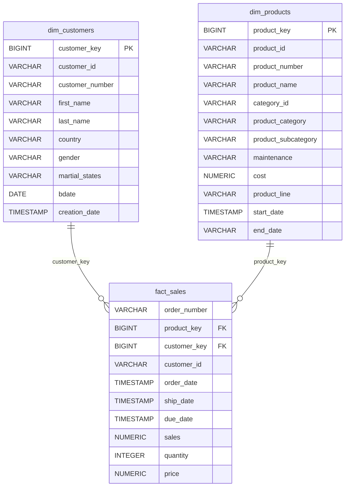

# Data Catalog: Gold Layer Views

This data catalog documents the dimensional models and fact table created in the **Gold Layer** (`gold` schema) derived from the **Silver Layer** staging tables (`silver.crm_*` and `silver.erp_*`).

---

## 1. Customer Dimension (`gold.dim_customers`)

### Purpose
Consolidates customer profile data by integrating CRM customer information (`silver.crm_cust_info`) with ERP demographic and location records (`silver.erp_cust_az12` and `silver.erp_loc_a101`). It provides a unified view of customer demographics, geographical location, and key identifiers for analytical reporting.

### Schema Details

| Column Name | Data Type | Description |
| :--- | :--- | :--- |
| `customer_key` | `BIGINT` | Generated surrogate key uniquely identifying each customer in the Gold layer (ordered by `cst_id`). |
| `customer_id` | `INTEGER` / `VARCHAR` | Primary CRM customer ID (`cst_id`). |
| `customer_number` | `VARCHAR` | Business key identifier (`cst_key`) used for joining with ERP systems. |
| `first_name` | `VARCHAR` | Customer's first name. |
| `last_name` | `VARCHAR` | Customer's last name. |
| `country` | `VARCHAR` | Customer's country of residence (e.g., `'United States'`, `'Germany'`, `'n/a'`). |
| `gender` | `VARCHAR` | Customer gender derived from CRM or ERP (e.g., `'Male'`, `'Female'`, `'n/a'`). |
| `martial_states` | `VARCHAR` | Customer's marital status (e.g., `'Single'`, `'Married'`, `'n/a'`). |
| `bdate` | `DATE` | Customer birth date from ERP records (e.g., `1985-06-15`). |
| `creation_date` | `DATE` / `TIMESTAMP` | Date when the customer record was created in CRM (e.g., `2023-01-10`). |

---

## 2. Product Dimension (`gold.dim_products`)

### Purpose
Stores comprehensive information about products offered by the business, combining CRM product master records (`silver.crm_prd_info`) with ERP product category classification (`silver.erp_px_cat_g1v2`). It supports product-level slice-and-dice analytics by category, subcategory, product line, and active timeframe.

### Schema Details

| Column Name | Data Type | Description |
| :--- | :--- | :--- |
| `product_key` | `BIGINT` | Generated surrogate key uniquely identifying each product in the Gold layer (ordered by `prd_id`). |
| `product_id` | `INTEGER` / `VARCHAR` | Unique internal product identifier from CRM (`prd_id`). |
| `product_number` | `VARCHAR` | Business product key (`prd_key`) used to map sales transactions. |
| `product_name` | `VARCHAR` | Name or description of the product. |
| `category_id` | `VARCHAR` / `INTEGER` | Foreign key referencing category hierarchy (`cat_id`). |
| `product_category` | `VARCHAR` | High-level product category (e.g., `'Bikes'`, `'Components'`, `'Accessories'`, `'Clothing'`). |
| `product_subcategory` | `VARCHAR` | Detailed product subcategory (e.g., `'Mountain Bikes'`, `'Road Bikes'`, `'Helmets'`). |
| `maintenance` | `VARCHAR` | Maintenance requirements or status flag from ERP (e.g., `'Yes'`, `'No'`, `'n/a'`). |
| `cost` | `NUMERIC` / `DECIMAL` | Base unit cost of the product. |
| `product_line` | `VARCHAR` | Product line classification (e.g., `'Road'`, `'Mountain'`, `'Touring'`, `'Components'`). |
| `start_date` | `DATE` / `TIMESTAMP` | Effective start date when the product was introduced (e.g., `2020-01-01`). |
| `end_date` | `VARCHAR` | Effective end date formatted as text, or `'n/a'` for active products (e.g., `'2025-12-31'`, `'n/a'`). |

---

## 3. Sales Fact (`gold.fact_sales`)

### Purpose
Contains transactional sales data (`silver.crm_sales_details`) enriched with foreign surrogate keys linking to `gold.dim_products` and `gold.dim_customers`. It acts as the central fact table for analyzing sales revenue, order volumes, and fulfillment performance across customer and product dimensions.

### Schema Details

| Column Name | Data Type | Description |
| :--- | :--- | :--- |
| `order_number` | `VARCHAR` | Unique identifier for the sales order line item (`sls_ord_num`). |
| `product_key` | `BIGINT` | Foreign surrogate key linking to `gold.dim_products.product_key`. |
| `customer_key` | `BIGINT` | Foreign surrogate key linking to `gold.dim_customers.customer_key`. |
| `customer_id` | `INTEGER` / `VARCHAR` | Natural CRM customer ID associated with the order (`sls_cust_id`). |
| `order_date` | `DATE` / `TIMESTAMP` | Date when the order was placed (e.g., `2024-03-15`). |
| `ship_date` | `DATE` / `TIMESTAMP` | Date when the order was shipped to the customer (e.g., `2024-03-18`). |
| `due_date` | `DATE` / `TIMESTAMP` | Payment or fulfillment due date (e.g., `2024-04-15`). |
| `sales` | `NUMERIC` / `DECIMAL` | Net sales revenue generated for the transaction line item. |
| `quantity` | `INTEGER` | Quantity of units ordered. |
| `price` | `NUMERIC` / `DECIMAL` | Selling price per unit. |

---

## Entity-Relationship Summary

